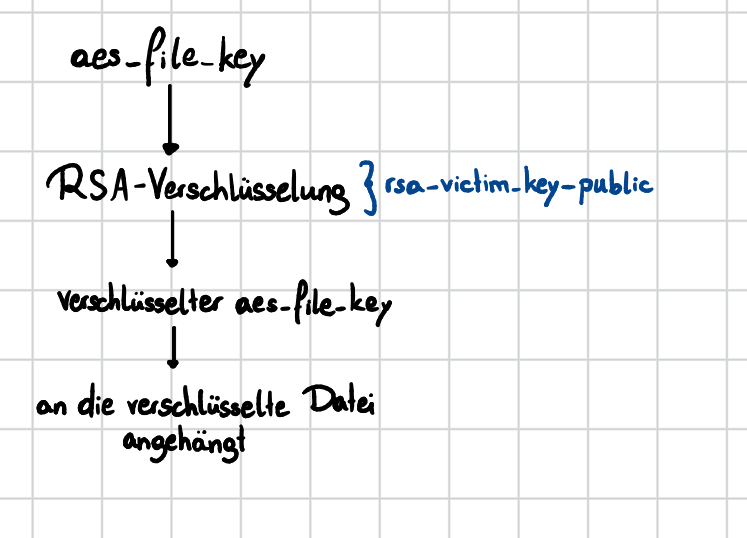
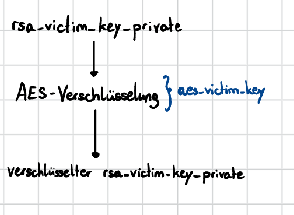
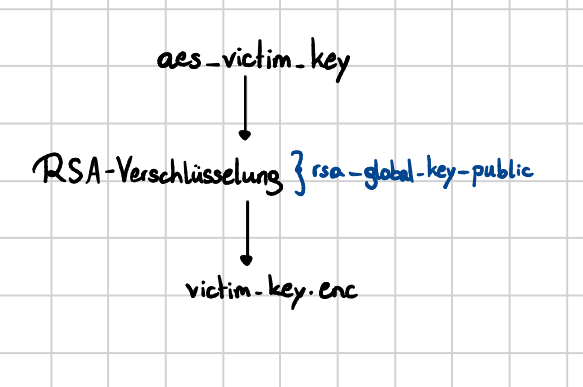
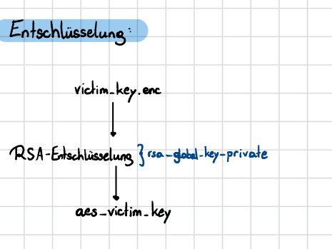
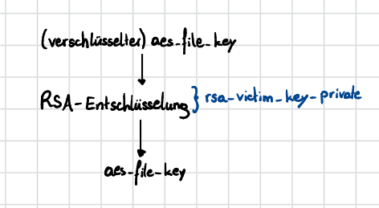

# Arbeitsbericht

- **Name:** Leah Petereder
- **Klasse:** 4AHITS
- **Datum:** 5.10.2026
- **Fach:** ITSE
- **Thema:** Ryuk Ransomware
- **Aufgabenstellung:** [Ryuk Ransomware](https://www.franzmatejka.at/htl/doc/ITSI/lab/ransom_ryuk/01_ryuk.html)

---
## Inhaltsverzeichnis
```
1. Argumentationskette
1.1 Funktionsweise von Ryuk
1.2 Ryuk-Red Team
```


# 1. Argumentationskette

**Warum AES-256-CBC für die einzelnen Dateien?**

Es eignet sich gut zum Verschlüsseln von großen Datenmengen, das es schnell ist. 

**Warum ein eigener Key für jede Datei?**

Dadurch verwenden dann nicht alle den selben Schlüssel und sind besser geschützt.

**Warum wird der AES-Key mit RSA verschlüsselt?**

Der Key darf nicht unverschlüsselt auf dem System des Targets gespeichert werden, deswegen verschlüsselt man es mit RSA.

**Warum wird der verschlüsselte AES-Key an die Datei angehängt?**

Dadurch kann der Schlüssel dann der zugehörigen Datei zugeordnet werden.

**Warum wird der `rsa_victim_key_private` mit AES verschlüsselt?**

Er darf nicht ungeschütz beim Target rumliegen deswegen wird er mit AES verschlüsselt, da er sonst zum entschlüsseln der Datei verwendet werden könnte.

**Warum wird ein globaler RSA-Key verwendet, um den `aes_victim_key` zu verschlüsseln?**

Es kann dann nur mehr mit dem privaten RSA Schlüssel wiederhergestellt werden. 

---

## 1.1 Funktionsweise von Ryuk

**Skizzen:**

### Verschlüsselung





### Entschlüsselung






## 1.2 Ryuk-Red Team

Erstmal einen neuen Ordner `Ryuk_RedTeam` erstellen und dort dann die Skript-Datei in VS Code erstellen `ryuk_redteam.sh` mit dem Inhalt:
```
#!/bin/bash

for file in "$@"
do
    if [ -f "$file" ]
    then
        echo "Die Datei wurde gefunden: $file"
        openssl dgst -sha256 "$file"
    else
        echo "Die Datei wurde nicht gefunden."

    fi
done


echo "Wonn du ma ned 10000000 Bitcoin überweißt, sog i deiner Mama, dass du mit 12 Schokolade gestohlen hast."
```

Es wird erstmal festgelegt, dass der Code mit **Bash** ausgeführt werden soll. Danach beginnt die for-Schleife mit `for file in "$@"`, womit man dann mehrere Files nacheinander bearbeiten kann.`file` ist der Variablenname und `"$@"` sind die Argumente die beim Start des Codes übergeben werden.

Danach wird mit `-f` überprüft, ob eine normale Datei existiert. Wenn die Datei exisitert dann wird ausgegeben, dass die Datei gefunden wurde und wenn nicht, dann nicht. Mit `openssl` wird das Programm verwendet, welches Funktion zur Kryptografie beinhaltet. Es wird hierbei `sha256` verwendet. 

Danach kommt die `Ransomeware-Notiz`:).

Nun erstellen wir 2 Test-dateien `test1.txt` und `test2.txt`

Jetzt im Terminal in den Ordner mit `cd Ryuk_RedTeam` wechseln und den Code mit den 2 Test Dateien ausführen:
```
┌──(kali㉿kali)-[~/Ryuk_RedTeam]
└─$ bash ryuk_redteam.sh test1.txt test2.txt                           
Die Datei wurde gefunden: test1.txt
SHA2-256(test1.txt)= a582e8c28249fe7d7990bfa0afebd2da9185a9f831d4215b4efec74f355b301a
Die Datei wurde gefunden: test2.txt
SHA2-256(test2.txt)= e3b0c44298fc1c149afbf4c8996fb92427ae41e4649b934ca495991b7852b855
Wonn du ma ned 10000000 Bitcoin überweißt, sog i deiner Mama, dass du mit 12 Schokolade gestohlen hast.
```

Hier wurden die Hashwerte berechnet in text1.txt befindet sich der Inhalt `Hallo Welt!` während test2.txt leer ist.

Um die Dateien jetzt zu verschlüsseln, verwendet man `AES-256-CBC` und gibt diese Zeile ein:
```
┌──(kali㉿kali)-[~/Ryuk_RedTeam]
└─$ openssl enc -aes-256-cbc -salt -pbkdf2 -in test1.txt -out test1.enc
enter AES-256-CBC encryption password:
Verifying - enter AES-256-CBC encryption password:

``` 

**Quelle für die Zeile:** https://docs.openssl.org/4.0/man1/openssl-enc/

Hierbei wird das Programm `openssl` erstellt und mit `enc` wird festegelgt das entschlüsselt bzw. verschlüsselt werden soll. 

Danach legen wir fest das wir `AES-256-CBC` verwenden um zu verschlüsseln. Es wird auch festgelegt, dass wir einen `Salt` verwenden um die Verschlüsselung noch sicherer zu machen.

Mit `pbkdf2` wird aus dem Passwort ein Schlüssel gemacht und dann wird angegeben welche Datei verschlüsselt werden soll und in welche Datei der Schlüssel gespeichert wird.

Daraufhin muss man ein Passwort eingeben und es wird die Datei `test1.enc` erstellt. Diese hat den Inhalt:
```
Salted__5���z0u�Y��y�5�������
```

## 1.3 Ryuk-Blue Team

Im Ordner `Ryuk_RedTeam` nun die Datei `ryuk_blueteam.sh` erstellen mit dem Inhalt:
```
#!/bin/bash

for file in "$@"
do
    if [ -f "$file" ]
    then
        echo "Die Datei wurde gefunden: $file"
        openssl enc -d -aes-256-cbc -pbkdf2 -in "$file" -out "$file.txt"
    else
        echo "Die Datei wurde nicht gefunden."
    fi
done
```

Hier werden wieder alle Dateien durchgegangen und geprüft, ob sie denn überhaupt existieren.

Danach wird sie entschlüsselt mittels `AES-256-CBC`, daraufhin wird das Passwort in einen Schlüssel umgewandelt und der entschlüsselte Inhalt wird dann in die neue Datei gespeichert.

Wenn man diese Funktion dann wieder ins Terminal eingibt:
```
┌──(kali㉿kali)-[~/Ryuk_RedTeam]
└─$ bash ryuk_blueteam.sh test1.enc                                    
Die Datei wurde gefunden: test1.enc
enter AES-256-CBC decryption password:
```
Hier muss man jedoch das Passwort zur Verschlüsselung verwenden, also muss dieses schon bekannt sein.
Es entsteht dann die neue Datei `test1.enc.txt` Hier steht dann der entschlüsselte Text wieder:
```
Hallo Welt!
```