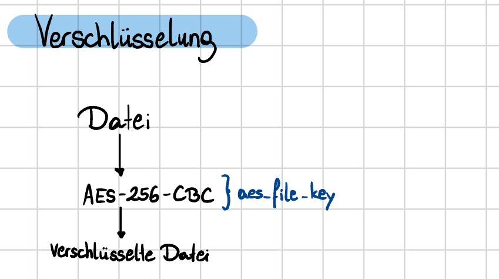
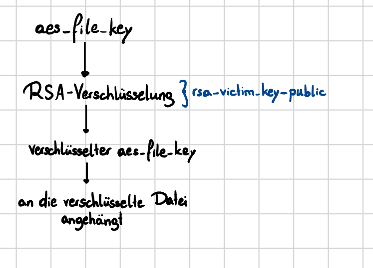
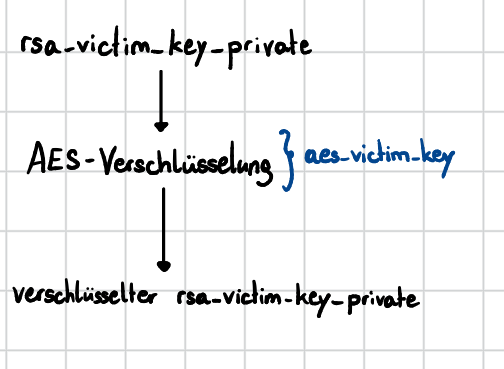
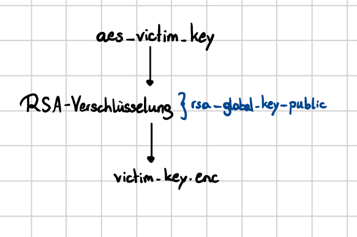

# Arbeitsbericht

- **Name:** Leah Petereder
- **Klasse:** 4AHITS
- **Datum:** 5.10.2026
- **Fach:** ITSE
- **Thema:** Ryuk Ransomware
- **Aufgabenstellung:** [Ryuk Ransomware](https://www.franzmatejka.at/htl/doc/ITSI/lab/ransom_ryuk/01_ryuk.html)

---
## Inhaltsverzeichnis
```
1. Argumentationskette
2. Funktionsweise von Ryuk
```


# 1. Argumentationskette

**Warum AES-256-CBC für die einzelnen Dateien?**

Es eignet sich gut zum Verschlüsseln von großen Datenmengen, das es schnell ist. 

**Warum ein eigener Key für jede Datei?**

Dadurch verwenden dann nicht alle den selben Schlüssel und sind besser geschützt.

**Warum wird der AES-Key mit RSA verschlüsselt?**

Der Key darf nicht unverschlüsselt auf dem System des Targets gespeichert werden, deswegen verschlüsselt man es mit RSA.

**Warum wird der verschlüsselte AES-Key an die Datei angehängt?**

Dadurch kann der Schlüssel dann der zugehörigen Datei zugeordnet werden.

**Warum wird der `rsa_victim_key_private` mit AES verschlüsselt?**

Er darf nicht ungeschütz beim Target rumliegen deswegen wird er mit AES verschlüsselt, da er sonst zum entschlüsseln der Datei verwendet werden könnte.

**Warum wird ein globaler RSA-Key verwendet, um den `aes_victim_key` zu verschlüsseln?**

Es kann dann nur mehr mit dem privaten RSA Schlüssel wiederhergestellt werden. 

---

## 2. Funktionsweise von Ryuk

**Skizzen:**





